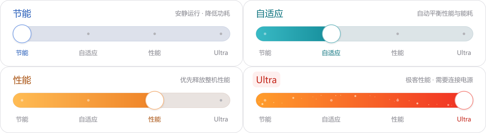

# ThinkVantage 0.5.3

面向 Windows 11 x64 的轻量设备设置工具，使用 C++20、Qt 6.12.0 Widgets 和 E:\Qt6 中的 MSVC 143 构建，针对 ThinkBook 16 G6+ IMH / 21LE 适配。

## 使用

解压整个文件夹后运行 ThinkVantage.exe，点击“管理员模式”可使用 GPU 模式、超频、开盖开机及 Fn/Ctrl 互换。启动时注册任务栏通知区域的绿色 T 托盘图标。关闭主窗口后继续留在托盘，右键“退出 ThinkVantage”完全退出。不安装系统服务，不自动添加开机启动。

## 托盘与快捷面板

主窗口和托盘中的整机性能使用软件实时绘制的分档滑块：节能、自适应、性能、Ultra（极客）。控件采用紧凑的当前档位、说明、轨道及四档文字标记。轨道、滑块、文字和粒子均由Qt QPainter绘制，不使用截图贴图。滑块带吸附和缓动，支持方向键及Home/End；拖动时仅预览，松开后才提交。档位由设备能力决定，Ultra仍要求接电。配色随性能档位由冷到暖变化：节能蓝、自适应青、性能橙、Ultra火红。标题、填充轨道、当前档位文字及键盘焦点同步配色，切换时以230ms缓动过渡。Ultra显示橙红渐变与暖白、金色粒子视效；动效只在可见时运行，隐藏或最小化后停止，并遵循Windows的界面动画设置。



后台读取现在采用静默、增量更新：控件保持可用，相同选项不再清空重建，下拉菜单与拖动过程保持；设备实际数值变化才更新。亮度、音量、开关及电池条使用短缓动。读取期间提交的操作会排队，只有对应控件显示等待状态，写入后先发布回读结果，再后台刷新关联数据。原始诊断信息在展开后按需更新，保留滚动位置与选区。

单击托盘图标打开快捷面板，双击打开主窗口。面板提供电量、供电、温度与可读取的GPU模式速览，以及9项快捷控制：性能模式、充电策略、键盘背光、亮度、音量、扬声器静音、麦克风静音、Fn Lock和触控板。底部可直接打开完整软件或进入对应设置页，按Esc或点击外部收起面板。

托盘面板关闭Windows额外添加的矩形弹出窗口投影，保留软件绘制的圆角柔和阴影。原生验证检查窗口样式，并额外保存包含窗口周边的实际屏幕截图，以覆盖控件内部截图看不到的外侧边缘。

快捷面板和主窗口共享异步设置进程、能力判断及回读；操作中的对应控件在两处同步显示等待，成功后同步设备回读结果。退出会等待当前操作结束。面板打开时定时刷新，后台仅轻量更新电量工具提示，不在隐藏状态反复调用原厂探测进程。

重复启动会唤起已有窗口，避免重复托盘图标；管理员重启会交接原实例。托盘显示位置由Windows管理，图标可能出现在“隐藏的图标”区域。

命令行：--tray 仅驻留托盘；--quick 打开快捷面板；--quit 请求当前实例退出。GUI单实例按当前用户与Windows会话隔离，控制通道只接受打开、显示面板及退出，不接受硬件写入请求。

按用户提供的 Vantage 电源、输入与人体存在检测图片补齐功能。原厂运行库提取到 vendor，Qt 和兼容的 MSVC 运行库一并打包；电池桥接使用 Windows 11 自带的 .NET Framework 4.x，不需要 .NET SDK。截图中的勾选状态不作为本机初始设置，界面始终读取当前真实值。

## 图片功能对照

0.3.1 重写了桌面界面：深色导航与青绿色强调色，相关功能合并为带分隔行的面板。入口精简为电源与性能、键盘与触控板、显示与感知、声音、设备信息。电池数据汇总展示，距离、锁定与超频参数默认折叠；系统设置入口合并为同一行链接。保留全部32项设备设置及原有状态回读。

| 图片项目 | 实现 |
|---|---|
| Battery health | 当前/满充/设计容量及对比条，容量比保留一位小数 |
| Temperature | 原厂电池温度，摄氏/华氏显示 |
| At a glance / View all | 充放电状态、循环、化学类型、供电；展开显示电压、电流、制造商、设计电压 |
| Screen and sleep | Windows 屏幕与睡眠设置入口 |
| Power modes | 自适应、节能、性能、极客；按能力提供，极客档要求接电 |
| GPU working mode | 混合、仅核显、自动；仅核显前查询独显占用，不自动关闭程序 |
| Conservation / Rapid | 标准、养护、快充三选一；支持 Storage80 时显示 75%/80% 原厂养护档 |
| Overnight charging | 原厂夜间充电开关 |
| GPU Overclocking | 开关及 GPU/显存偏移；固件范围与插件范围取交集，本机 0–200/0–400 MHz |
| Flip to start | 原厂 FBSWIF，保留未知字节及属性 |
| Always on USB | 接电、电池供电分别控制 |
| Keyboard backlight | 自动、低、高、关闭，按固件档位显示；Fn + Space |
| Remember my selection | 原厂 KBLR 固件背光记忆 |
| Function lock | 原厂 Fn Lock 开关；Fn + Esc |
| CapsLk / NumLock OSD | 控制 Lenovo 热键服务的屏幕提示，各自独立 |
| Fn & Ctrl swap | BIOS Assistant 能力位及 Get/SetValue，需管理员权限 |
| Touchpad | 内置精确式触控板实际开关，采用原厂使用的 Windows 快捷键路由并回读状态 |
| Zero touch login | 靠近唤醒，自动/手动距离；自动登录仍需要 Windows Hello |
| Zero touch lock | 离开锁定、快速/中速/慢速、自动/手动距离、人脸识别辅助 |
| Zero touch video playback | 原厂视频自动暂停/恢复开关 |

人体感知集中在“显示与感知”页面，提供可折叠高级设置及公制/英制距离显示。唤醒/锁定关闭时其高级控制禁用；自动距离开启时手动距离禁用。距离按传感器适配：本机 VL53L5 的唤醒档为 0.55/1.0/1.5 米，锁定档为 0.9/1.2/1.5 米；VL53L1 唤醒档为 0.42/0.6/1.2 米。其他传感器只显示近/中/远，不套用未知范围。距离是原厂界面标称范围，实际行为取决于驱动、传感器和环境。

这些策略由本机已有 Lenovo Smart Sense 和热键服务执行，本程序无需常驻。人脸辅助由原厂服务处理，需相机权限；视频控制只对原厂支持的播放场景有效。

超频关闭时锁定偏移滑条；开启要求接电，自适应性能会先切至性能档。写入必须回读确认，失败时尝试恢复本程序刚改变的性能档。

## 依赖与验证边界

本版按用户授权集成本机原厂运行库及配置，文件保持原样，来源、大小和 SHA-256 见 vendor/manifest.json，原厂许可保留在各目录。原厂文件仍是专有组件，其原有授权条款不因本项目改变。

仍需要本机 Lenovo 驱动、LenovoProcessManagement 和 NVIDIA 驱动；提取用户态运行库不等于替代驱动或系统服务。Vantage RPC 拒绝未受信任客户端，本项目使用已核对的驱动、WMI、SCM 及 DLL 接口，不修改其服务信任或原厂二进制。

原厂 GPU 插件旧 GetAbility 在本机返回 0，GameZone 则明确报告支持及 200/400 MHz 范围；本版记录差异，按固件能力与成功参数读取开放控件，写入仍要求真实回读。此次没有启用超频或施加非零偏移。

保留 Windows 电源模式、亮度/刷新率、音量/静音、麦克风静音及诊断导出。Dolby、联想智能降噪尚未接入。详见 docs/VALIDATION.md。

## 构建

```powershell
cd E:\Code\ThinkVantage
.\scripts\build.ps1 -Package
python .\tests\integration.py .\dist\ThinkVantage-0.5.3-win64\ThinkVantage.exe --report .\research\integration-readonly.json
```

工具链：Qt 6.12.0 msvc2022_64、MSVC 143 19.44、Windows SDK 10.0.26100.0。extract-vendor.ps1 从本机固定版本组件提取运行库，以 Framework64 csc 编译隔离桥接程序。构建只修改当前进程环境变量。

--probe 返回只读 JSON；--ui-smoke --screenshot <绝对路径.png> 导出各页面及完整电源页后退出。内部 --apply 接受固定 ID 与数值，频率另查设备范围和步长。

集成测试默认只读、拒绝非法请求及已禁用的高级控制。--same-value-writes 会将可用设置写回执行前当前值，新增输入与人体感知设置也在其中；仅当超频原本关闭时验证关闭命令，刷新率恢复测试也保持原值。--input-roundtrip 会临时切换背光记忆、Caps/Num Lock 提示和触控板，并逐项立即恢复。所有测试结束后检查设置前后一致。新版验证脚本为 scripts/verify-smooth.ps1；tests/tray_lifecycle.py 验证后台启动、单实例、关闭到托盘、面板、Esc、退出和重启。--tray-smoke --verify-adjustment 会在后台读取期间经实际面板音量滑条请求增加1个百分点，核对排队执行与设备实际档位并恢复原值，仅供开发验证。独立ui_tests只绘制Ultra，不切换硬件性能。

支持硬件音量的设备可能将百分比请求映射到最近的分贝档位。本程序只有在设备报告硬件音量支持、读回值落在有效档位且为请求分贝的最近档位时才接受这种差异，并显示实际音量。其他设置仍要求目标值精确回读。

第三方说明见 THIRD_PARTY_NOTICES.md，原创源码尚未指定开源许可证。
